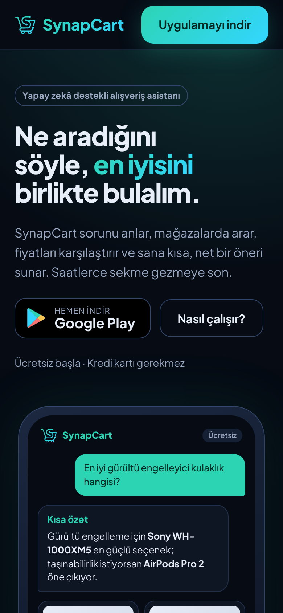
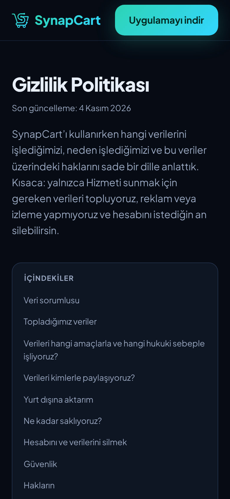
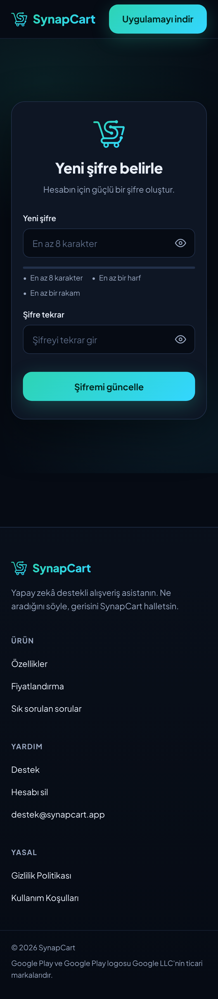
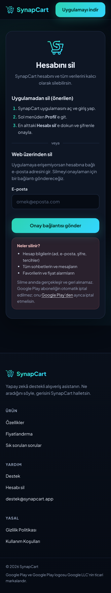
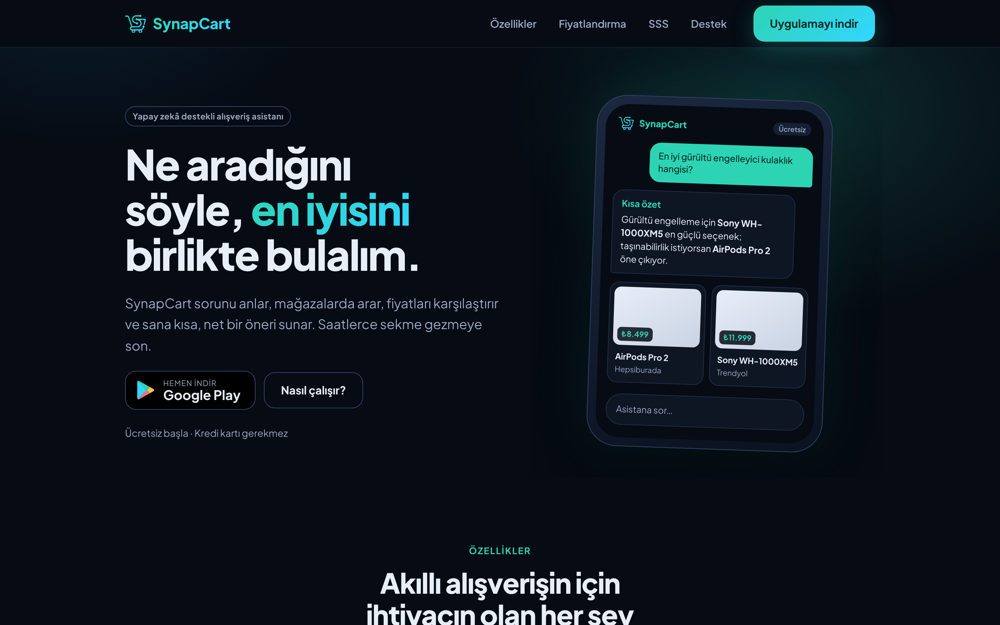

# SynapCart

**An AI shopping assistant for Android.** Tell SynapCart what you're looking for in plain language. It searches Google Shopping across stores, compares the offers and gives you a short, clear recommendation with product cards you can save, track and compare.

This is the umbrella repository. It holds the three apps as git submodules, plus the shared design assets and the docs:

| Path | Repo | What it is |
|---|---|---|
| [`backend/`](https://github.com/emreaydindev/synapcart_backend) | `synapcart_backend` | FastAPI + LangGraph agent (Gemini, SerpAPI Google Shopping), plans and quota, Play billing, price alerts |
| [`mobile/`](https://github.com/emreaydindev/synapcart_mobile) | `synapcart_mobile` | Android app: Kotlin, Jetpack Compose, Hilt, Retrofit/OkHttp, Play Billing, Firebase Messaging |
| [`web/`](https://github.com/emreaydindev/synapcart_web) | `synapcart_web` | Next.js site: landing, privacy/terms/support, account deletion, password reset, `assetlinks.json` |
| `design/` | | Logo and screenshots |
| `docs/` | | [Publishing roadmap](docs/ROADMAP.md) |

```bash
git clone --recurse-submodules https://github.com/emreaydindev/synapcart
# or, in an existing clone:
git submodule update --init --recursive
```

The app is in Turkish by default and also ships in English, with a per-app language picker. The assistant replies in the user's language.

## Plans

SynapCart is free to use, with an optional **Premium** subscription sold through Google Play (monthly or yearly). The limits come from [`backend/app/services/plan_service.py`](https://github.com/emreaydindev/synapcart_backend/blob/claude/init-dno428/app/services/plan_service.py). The web landing page and the in-app paywall show the same numbers.

| | Free | Premium |
|---|---|---|
| Assistant messages per day | 5 | 100 (fair-use cap) |
| Products per search | 3 | 8 |
| Analysis model | `gemini-2.5-flash-lite` | `gemini-2.5-flash` (`PREMIUM_ANALYST_MODEL`) |
| Chat history | Last 10 chats (older ones are locked, not deleted) | Unlimited |
| Price-drop alerts | – | ✓ |
| AI product comparison (2–4 products) | – | ✓ |

Daily quotas reset at 00:00 UTC. Premium falls back to Free automatically once the subscription expires. Payments, renewals, cancellations and refunds are handled by Google Play.

## Architecture

```
 ┌──────────────────────┐    HTTPS /api/v1    ┌────────────────────────────┐
 │  Android app         │ ──────────────────▶ │  FastAPI backend (Render)  │
 │  (mobile/)           │ ◀── SSE stream ──── │  LangGraph agent           │
 │  Play Billing ───────┼── purchase token ─▶ │  Gemini · SerpAPI          │
 │  FCM ◀───────────────┼──── price alerts ── │  PostgreSQL (Alembic)      │
 └──────────────────────┘                     │  daily price-check cron    │
            ▲  synapcart://, https links      └────────────▲───────────────┘
            │                                              │ /api rewrite
 ┌──────────┴───────────┐                                  │
 │  Next.js web (Vercel)│ ─────────────────────────────────┘
 │  (web/)              │   reset-password, delete-request/confirm
 └──────────────────────┘
        ▲ Google Play ── RTDN (Pub/Sub push) ──▶ backend /billing/google/rtdn
```

- **Backend** (`backend/`). FastAPI serves everything under `/api/v1`: `/auth`, `/chat`, `/favorites`, `/user`, `/billing` and `/health`.
  - **Auth:** HS256 JWTs that are valid for 7 days (`ACCESS_TOKEN_EXPIRE_MINUTES`). A password change or reset bumps `token_version`, which revokes every token already issued.
  - **Rate limits:** slowapi limits auth requests per IP and agent requests per user.
  - **Schema:** Alembic migrations are the source of truth.
  - **Agent:** a LangGraph graph (router → searcher → analyst, or a refusal). `POST /chat/agent/{id}/stream` runs that same graph and streams Server-Sent Events: `routing` → `searching` → `thinking` (with products) → `completed` (with the analysis and products). It can end with `out_of_scope` or `error` instead. Only the final answer and its products are saved, so reopening a chat restores the product cards.
- **Plans and quota.** `plan_service.get_limits(user)` decides the message quota, how many products a search returns, which analysis model runs and how much history is unlocked.
  - The quota is counted per day in `usage_daily`.
  - When a limit is hit, the backend returns HTTP 402 `{detail, code}` with `code` `quota_exceeded`, `premium_required` or `history_locked`. The app opens the paywall on any of these.
- **Billing.** The app buys the `synapcart_premium` subscription with Play Billing and binds the purchase to the user id.
  - It sends the purchase token to `POST /billing/google/verify`, which checks it with the Play Developer API (`purchases.subscriptionsv2`) and sets the plan and expiry. The app acknowledges the purchase only after the server has verified it.
  - Renewals, cancellations and refunds arrive as Real-time Developer Notifications at `POST /billing/google/rtdn`.
  - Purchases are restored when the app starts.
- **Price alerts.** A Premium user sets a target price on a favorite (`PATCH /favorites/{id}`), and the app registers its FCM token (`POST /user/me/device-token`).
  - A daily Render cron job (`python -m app.jobs.price_check`) re-searches those products. When a price is at or below the target, it sends a push through FCM HTTP v1.
  - Tapping the notification opens the product in the app.
- **Compare.** Premium users pick 2–4 products, and `POST /chat/compare` asks Gemini for a structured comparison: pros and cons for each product, the recommended item and a verdict, in the user's language.
- **Web** (`web/`). The Next.js site on Vercel rewrites `/api/*` to the backend.
  - It hosts the pages the Play listing needs: privacy, terms, support and the web account-deletion URL.
  - The backend's emails link to `/reset-password?token=…` and `/delete-account?token=…`.
  - After a password reset, the site opens the app through `synapcart://login`.
  - `/.well-known/assetlinks.json` verifies the app's `https://synapcart.app` links.

## Local development

Run the backend first, because the app and the website both talk to it on port **8001**.

### Backend

```bash
cd backend
python -m venv .venv && source .venv/bin/activate
pip install -r requirements-dev.txt
cp .env.example .env        # fill in GEMINI_API_KEY, SERP_API_KEY, SECRET_KEY, SMTP_*
uvicorn app.main:app --host 0.0.0.0 --port 8001 --reload   # Swagger at http://localhost:8001/docs
pytest                      # tests need no API keys (Gemini and SerpAPI are mocked)
alembic check               # models and migrations agree
```

Migrations run on startup in dev (`AUTO_MIGRATE`). Billing and FCM stay disabled until their service-account keys are set. See `backend/.env.example`.

### Mobile

Open `mobile/` in Android Studio, or use Gradle (JDK 17+, Android SDK with compileSdk 36.1):

```bash
cd mobile
./gradlew installDebug      # debug talks to http://10.0.2.2:8001/ (the emulator's host)
./gradlew installDebug -PdebugBaseUrl=http://192.168.1.10:8001/   # a physical device on your LAN
./gradlew test lint
./gradlew assembleRelease   # R8 release; signed when keystore.properties exists
```

- Push notifications need `app/google-services.json` from your Firebase project. Without it the app builds and runs, but without FCM.
- Play Billing only works for builds installed from a Play test track.

### Web

```bash
cd web
npm install
cp .env.example .env.local  # NEXT_PUBLIC_API_URL=http://localhost:8001
npm run dev                 # http://localhost:3000
npm run lint && npm run build
```

## Live services

- **Website:** [synapcart-web.vercel.app](https://synapcart-web.vercel.app)
- **API:** [synapcart-backend.onrender.com](https://synapcart-backend.onrender.com/api/v1/health)

The backend runs on Render's free tier, so the first request after an idle period can take a while.

### Legal and support pages

- [Privacy Policy](https://synapcart-web.vercel.app/privacy) (KVKK and GDPR)
- [Terms of Use](https://synapcart-web.vercel.app/terms) (including subscription terms)
- [Support](https://synapcart-web.vercel.app/support)
- [Delete your account](https://synapcart-web.vercel.app/delete-account)

## Screenshots

### Web

| Landing | Privacy | Reset password | Delete account |
|---|---|---|---|
|  |  |  |  |



Desktop captures of every page are in [`design/screenshots/`](design/screenshots/).

### Android app

> **TODO (owner):** app screenshots aren't captured yet, because there is no emulator in the cloud build environment. Add them to `design/screenshots/` as `app-<screen>.png` (1080×2400 or similar) and replace this note with a table.
>
> Screens to capture: onboarding, dashboard with a streamed answer and product cards, product details (with the price-alert dialog), favorites (with an alert bell), compare, paywall, and profile with the plan card.
